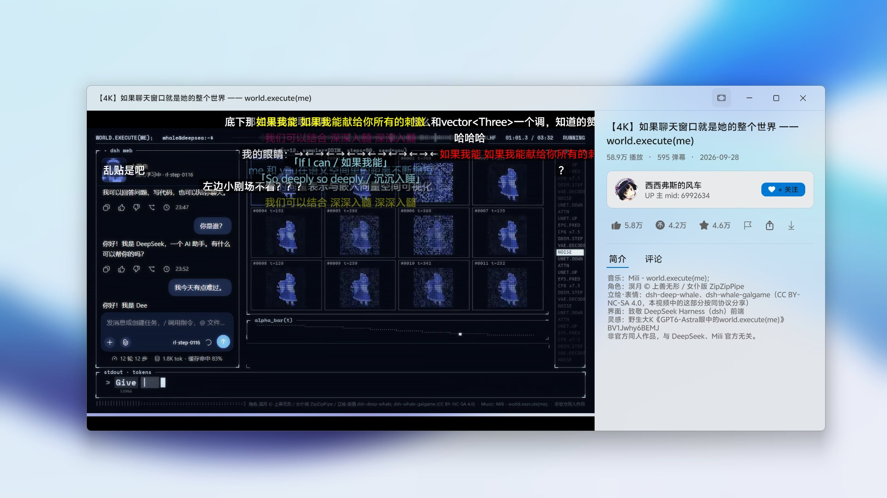

<div align="center">
  <h1>ailiaili</h1>
  
  <p><a href="https://github.com/shiaho777/ailiaili/actions/workflows/ci.yml"></a></p>
  <p>An unofficial Bilibili client for Android, Windows, macOS, and Linux.</p>
  <p><a href="#download">Download</a> · <a href="https://github.com/shiaho777/ailiaili/issues">Report a problem</a> · <a href="README.zh-CN.md">简体中文</a></p>
</div>

## Supported platforms

| Platform | Runtime and installation |
| --- | --- |
| Android | Android 8.0 (API 26) or later. Uses Media3. A debug APK is available from CI. |
| Windows | Build an MSI on Windows. |
| macOS | Build a DMG on macOS. |
| Linux | Build a DEB on Linux. |

Desktop builds use LibVLC. Install VLC for the same architecture as the app.

## Screenshots

<p align="center">
  
  
</p>

## Features

- Browse recommendations, charts, categories, creator profiles, and the activity feed. Search for videos, live rooms, series, and users.
- Watch videos and live streams with danmaku. Use subtitles, quality and speed controls, resume playback, and optionally skip sponsored segments with SponsorBlock.
- Sign in by QR code to access history, favorites, Watch Later, messages, and account interactions. Save videos for offline playback.
- Customize the theme, font, and content filters. Desktop builds support keyboard shortcuts, a system tray where available, and a custom cache directory.

<details>
<summary>Playback and platform notes</summary>

- Stream quality and subtitles depend on the video, account, and device. Bilibili often limits AI subtitles to signed-in users.
- Android stores downloads in its app cache and can merge compatible offline tracks into an MP4. Desktop downloads retain separate audio and video tracks.

</details>

See the [release notes draft](static/doc/release-notes.md) for changes still in development.

## Download

There are currently no release installers on [GitHub Releases](https://github.com/shiaho777/ailiaili/releases).

- **Android preview.** Sign in to GitHub, open a recent successful run for `main` in [GitHub Actions](https://github.com/shiaho777/ailiaili/actions/workflows/ci.yml?query=branch%3Amain), and download `android-debug-apk` under **Artifacts**. After extracting the archive, find the APK in the Android build’s `debug` folder. The archive root includes `SHA256SUMS`. A CI preview may be older than this checkout. CI keeps artifacts for 14 days. This build uses a debug signing key.
- **Desktop or expired artifacts.** Build from source using the commands below. Package desktop installers on the target operating system.

## Build from source

Use JDK 21 to run Gradle, matching CI. Desktop builds also need a JDK 17 available to Gradle's toolchain and a local VLC installation for playback. For Android, configure the SDK path and install SDK Platform 37.0 and Build Tools 37.0.0.

```sh
./gradlew :androidApp:assembleDebug
./gradlew :desktopApp:run
./gradlew :desktopApp:packageDistributionForCurrentOS
```

The debug APK is in the `debug` subfolder of `androidApp/build/outputs/apk/`. Desktop packages are under `desktopApp/build/compose/binaries/`. On Windows, use `gradlew.bat`.

## Contribute and get help

Check the [issue tracker](https://github.com/shiaho777/ailiaili/issues) for existing reports. Include the app version, platform, and reproduction steps in bug reports. Review logs or screenshots for private information before posting.

For changes, use an existing issue when one covers the work, open a pull request against `main`, and include the checks you ran. A PR that fixes an issue can use `Fixes #123` to close it on merge. The [development guide](static/doc/development.md) covers the code layout and shared conventions. [CI](.github/workflows/ci.yml) defines JVM tests, desktop compilation, and the Android debug build.

## License and credits

Source code is licensed under [GPL-3.0](LICENSE). ailiaili is an unofficial, noncommercial project independent of Bilibili. Bilibili content and trademarks remain with their respective owners.

Thanks to [BiliDesk](https://github.com/ABING1111/BiliDesk), Kotlin, Compose Multiplatform, Media3, LibVLC, OkHttp, Coil, and the contributors to these projects.
