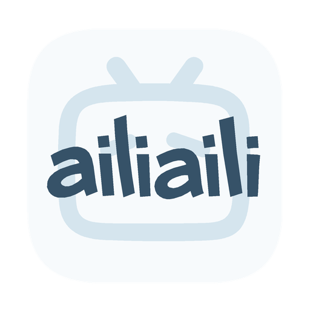
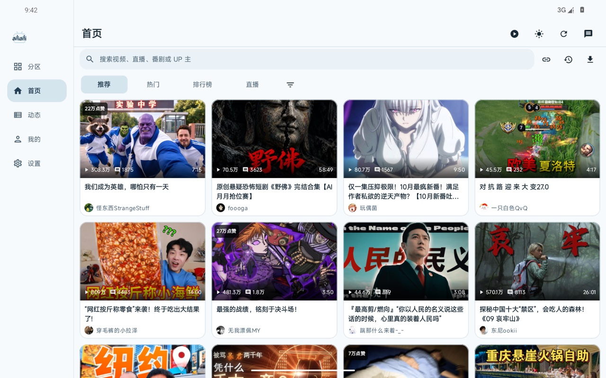
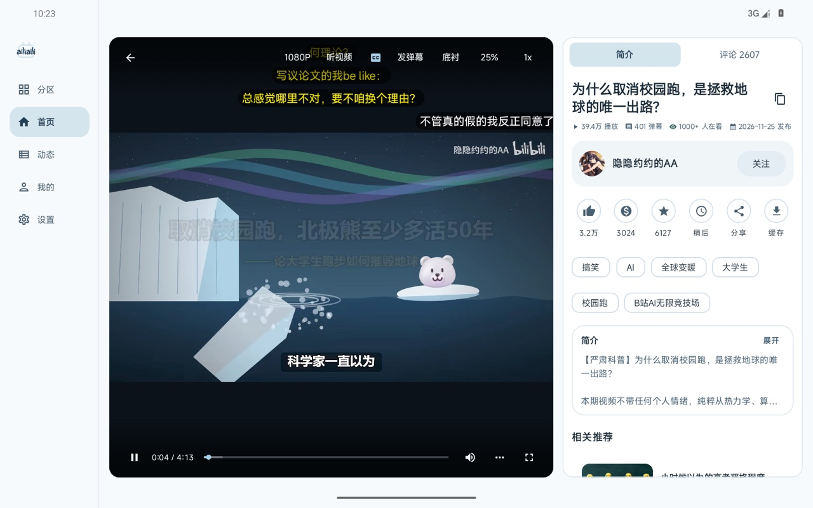

<div align="center">
  <h1>ailiaili</h1>
  
  <p><a href="https://github.com/shiaho777/ailiaili/actions/workflows/ci.yml"></a></p>
  <p>支持 Android、Windows、macOS 和 Linux 的第三方哔哩哔哩客户端。</p>
  <p><a href="#下载">下载</a> · <a href="https://github.com/shiaho777/ailiaili/issues">反馈问题</a> · <a href="README.md">English</a></p>
</div>

## 支持平台

| 平台 | 运行条件与安装方式 |
| --- | --- |
| Android | Android 8.0（API 26）及以上，使用 Media3。可从 CI 下载调试 APK。 |
| Windows | 在 Windows 上构建 MSI。 |
| macOS | 在 macOS 上构建 DMG。 |
| Linux | 在 Linux 上构建 DEB。 |

桌面端使用 LibVLC，需安装与应用架构一致的 VLC。

## 截图

<p align="center">
  
  
</p>

## 功能

- 首页默认进入视频网格。点击右上角片流按钮开启沉浸播放。导航、搜索和评论跟随应用明暗主题，播放操作浮在画面上。预览默认静音，手机可上下滑动换片，桌面支持滚轮和方向键。通过网格入口或桌面端 Esc 可返回网格。
- 搜索、动态、我的和完整播放器沿用片流的导航和控件。底部导航和设置页签悬浮在内容上，设置会记住各页签的滚动位置。网格浏览突出视频封面，页面过渡支持减少动态效果。未登录时也可从「我的」进入本机离线缓存。
- 浅色用冷白。深色参考 Chromium 基础调色板，用中性灰区分层次，以浅蓝突出主要操作、选中状态和进度。可在外观设置中选择和预览自定义主题色。新安装默认跟随系统明暗。手机采用悬浮导航，宽屏展开侧栏。完整播放器的控件浮在画面上，视频区宽时单行排列，窄时给进度条单独一行。桌面端移动鼠标或手机端点按画面可唤出控件。
- 分区可按名称筛选，分区详情可切换封面或列表。私信可筛选未读，历史和收藏可从「我的」进入。视频和直播历史各自保留筛选条件与滚动位置。
- 在 UP 主空间打开单条动态，按热门或最新查看评论。番剧详情可展开简介、选择单集或从第一集连续播放。支持搜索视频、直播、番剧与用户。
- 输入时会提示匹配的历史记录和热搜词，历史记录可以逐条移除。搜索框支持直接粘贴 B 站链接，并提示将要打开的内容、分 P 和时间点。
- 播放视频和直播，支持弹幕、字幕、画质与倍速调节、续播，也可启用 SponsorBlock 跳过赞助片段。
- 播放器支持临时清屏，隐藏画面上的弹幕并保留字幕。音量菜单可一键静音，解除静音时恢复之前的音量。
- 首页推荐可接着看最近一条未播完的在线视频。收起卡片后仍保留播放进度。播放器的「分享此刻」可复制带分 P 和时间点的链接，粘贴到搜索框或通过首页的「粘贴链接」打开。
- 扫码登录后可同步历史、收藏、稍后再看、私信及互动。收藏夹可切换封面或列表，并记住上次选择。
- 可以批量将分 P 加入下载队列。在**我的 → 离线缓存 → 下载任务**暂停、继续或重试。Android 支持通过系统通知在后台下载，也可设置仅在非计费网络下载。重启 App 后可继续未完成的任务。已完成缓存可按标题或 BV 号搜索。
- 下载任务可按状态筛选并批量重试失败项。设置搜索可直接定位到快进和快退步长、字幕字号、下载保存位置等具体项目。
- 下载时可一并保存可用的字幕和弹幕，断网时也能播放。完整播放器支持适应、裁切和拉伸画面，全屏时可锁定控件以防误触。
- 设置可按关键词检索，可配置启动页、快进步长、弹幕时间偏移及默认下载画质。可自定义主题和内容屏蔽规则。界面和弹幕默认使用 MiSans，可在**设置 → 通用**切换到系统默认字体或导入字体。桌面支持快捷键、系统托盘（取决于平台）和自定义缓存目录。

<details>
<summary>播放与平台限制</summary>

- 画质与字幕取决于视频、账号和设备。B 站通常只向登录用户提供 AI 字幕。
- Android 可将兼容的离线音视频轨道合成 MP4。开发版中的自定义下载目录用于导出，应用缓存仍保留一份。桌面下载保留独立的音视频轨道。
- 开发版的全局媒体键仅支持 Windows。macOS 和 Linux 也可使用窗口内快捷键。
- 睡眠定时器在播放页打开时生效。开播通知要求应用保持运行。应用内代理覆盖 API、图片、下载与直播弹幕请求，媒体流由播放引擎自行连接。

</details>

开发中的变更见[发行说明草稿](static/doc/release-notes.md)。

## 下载

[GitHub Releases](https://github.com/shiaho777/ailiaili/releases) 目前还没有发布安装包。

- **Android 预览版。** 登录 GitHub，在 [GitHub Actions](https://github.com/shiaho777/ailiaili/actions/workflows/ci.yml?query=branch%3Amain) 里打开近期运行成功的 `main` 构建，在 **Artifacts** 下载 `android-debug-apk`。解压后可在 Android 构建的 `debug` 子目录找到 APK，压缩包根目录有 `SHA256SUMS`。CI 预览的版本可能早于当前源码。CI 产物保留 14 天，APK 使用调试签名。
- **桌面端或 CI 产物已过期。** 可按下文从源码构建。桌面安装包需在对应系统上打包。

## 从源码构建

Gradle 使用与 CI 一致的 JDK 21。桌面构建还需为 Gradle 工具链提供 JDK 17，运行时需安装 VLC。构建 Android 前，请配置 SDK 路径并安装 SDK Platform 37.0 和 Build Tools 37.0.0。

首次构建时，Gradle 从小米官网下载 MiSans Regular 并校验 SHA-256。

```sh
./gradlew :androidApp:assembleDebug
./gradlew :desktopApp:run
./gradlew :desktopApp:packageDistributionForCurrentOS
```

Android 调试 APK 位于 `androidApp/build/outputs/apk/` 下的 `debug` 子目录，桌面安装包位于 `desktopApp/build/compose/binaries/`。Windows 使用 `gradlew.bat`。

## 贡献与反馈

请先在 [Issues](https://github.com/shiaho777/ailiaili/issues) 查找已有反馈。报告问题时请附上版本、平台和复现步骤。可以在**设置 → 关于**复制版本号，反馈播放或网络问题时也可复制诊断信息。提交前请检查诊断信息、日志和截图中的隐私内容。

贡献改动时，请复用已有的相关 Issue，向 `main` 提交 PR，并说明实际执行过的验证。修复对应 Issue 时可用 `Fixes #123` 在合并时关闭它。[开发指南](static/doc/development.md) 记录代码结构与共用约定，[CI 配置](.github/workflows/ci.yml) 包含 JVM 测试、桌面编译和 Android 调试构建。

运行 `./gradlew verifyJvm` 可执行与 CI 相同的 JVM 测试和桌面编译。

## 许可与致谢

源码采用 [GPL-3.0](LICENSE) 许可证。ailiaili 是非官方、非商业的独立项目，与哔哩哔哩官方无关。哔哩哔哩内容和商标归各自权利人所有。

MiSans 字体由小米提供，遵循 [MiSans 字体许可协议](https://hyperos.mi.com/font/download/)。

感谢 [BiliDesk](https://github.com/ABING1111/BiliDesk)、Kotlin、Compose Multiplatform、Media3、LibVLC、OkHttp、Coil 及这些项目的贡献者。
